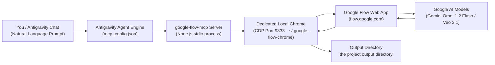

# ⚡ Antigravity × Google Flow MCP Integration Guide

> **File:** `flowmcp.md`
> **Target:** Google Antigravity (App, CLI, IDE) ↔ Google Flow (`flow.google.com` / `labs.google/fx/tools/flow`)  
> **Server Package:** `@park-sang-gwon/google-flow-mcp` (Version 0.3.1+)  
> **Runtime:** Node.js v22+ / npx / Google Chrome (CDP Port 9333)

---

## 1. Architecture Overview

Google Flow does not offer a standalone public REST API for individual creators. Instead, the integration uses the **Model Context Protocol (MCP)** combined with **Chrome DevTools Protocol (CDP)** browser automation.



### Key Security & Privacy Highlights:
* **No Account Sharing:** Your Google account credentials, passwords, and 2FA keys are never shared with Antigravity, third-party cloud servers, or exposed in plain text.
* **Local Session Storage:** The browser state, cookies, and tokens remain strictly inside your local Windows user directory (`C:\Users\ADMIN\.google-flow-chrome`).
* **Credit Safeguard:** Generation requests require confirmation (`auto_confirm: false` by default) to prevent accidental credit consumption.

---

## 2. Configuration Files & Registered Locations

Antigravity registers MCP servers through standard JSON configuration manifests. For complete cross-environment availability, the `google-flow` server definition is declared in three locations:

### 2.1 Configuration Schema
```json
{
  "mcpServers": {
    "google-flow": {
      "command": "npx",
      "args": [
        "-y",
        "@park-sang-gwon/google-flow-mcp"
      ]
    }
  }
}
```

### 2.2 Active File Locations

| Environment | File Path | Status |
| :--- | :--- | :---: |
| **Active Antigravity App** | `C:\Users\ADMIN\.gemini\antigravity\mcp_config.json` | ✅ Configured |
| **Global Machine Config** | `C:\Users\ADMIN\.gemini\config\mcp_config.json` | ✅ Configured |
| **Antigravity IDE** | `C:\Users\ADMIN\.gemini\antigravity-ide\mcp_config.json` | ✅ Configured |
| **MCP Internal Settings** | `C:\Users\ADMIN\.config\google-flow-mcp\config.json` | ✅ Configured |

### 2.3 MCP Internal Config (`config.json`)
The server’s own configuration file resides at `C:\Users\ADMIN\.config\google-flow-mcp\config.json`:
```json
{
  "chromePath": "C:\\Program Files\\Google\\Chrome\\Application\\chrome.exe",
  "userDataDir": "C:\\Users\\ADMIN\\.google-flow-chrome",
  "profileDirectory": "Default",
  "cdpPort": 9333,
  "flowUrl": "https://flow.google.com",
  "stateDir": "C:\\Users\\ADMIN\\.google-flow-mcp",
  "generationTimeoutMs": 1800000,
  "pollIntervalMs": 6000,
  "lockWaitMs": 10000,
  "logLevel": "info"
}
```

---

## 3. One-Time Setup & Authentication Protocol

Follow these steps whenever setting up on a new machine or refreshing an expired Google session:

### Step 1: Initialize MCP Configuration
```powershell
npx -y @park-sang-gwon/google-flow-mcp init
```
*Generates the default `config.json` linking Chrome, CDP port 9333, and the user data directory.*

### Step 2: Launch Dedicated Chrome & Log In
Launch Chrome with the dedicated profile flag:
```powershell
Start-Process "C:\Program Files\Google\Chrome\Application\chrome.exe" -ArgumentList '--user-data-dir="C:\Users\ADMIN\.google-flow-chrome"', 'https://flow.google.com'
```
1. In the Chrome window that opens, sign in with your Google account.
2. Confirm you can access `flow.google.com` and verify your available credit balance.
3. You can leave Chrome open or close it; your session cookies remain saved in `C:\Users\ADMIN\.google-flow-chrome`.

### Step 3: Run Diagnostics
```powershell
npx -y @park-sang-gwon/google-flow-mcp doctor
```
Expected output:
```text
ok   config: C:\Users\ADMIN\.config\google-flow-mcp\config.json
ok   chrome: C:\Program Files\Google\Chrome\Application\chrome.exe
ok   user-data-dir: C:\Users\ADMIN\.google-flow-chrome
ok   state-dir: C:\Users\ADMIN\.google-flow-mcp
ok   cdp: port 9333 free (Chrome will be launched)
ok   flow: logged in (https://flow.google.com/about)
```

---

## 4. MCP Tool Reference

Once connected, Antigravity exposes the following tools through the `google-flow` server namespace:

| Tool Name | Type | Description | Key Arguments |
| :--- | :---: | :--- | :--- |
| `flow_connect` | Action | Launches Chrome (if needed) and verifies session login status. | `open_url` *(optional)* |
| `flow_status` | Read-only | Reports connection state, active project/scene, and in-flight jobs. | *None* |
| `flow_screenshot` | Read-only | Captures a high-resolution PNG screenshot of the Flow tab. | `label`, `full_page` |
| `flow_inspect` | Action | Inspects DOM elements, clicks buttons, types text, and discovers UI selectors. | `action`, `target`, `text`, `at` |
| `flow_project_open` | Action | Navigates to a specific project URL and synchronizes the media grid. | `project_url` *(required)* |
| `flow_generate_video` | Action | Prepares or triggers video generation via the composer. | `prompt`, `project_url`, `output_dir`, `model`, `duration`, `ratio`, `auto_confirm` |
| `flow_generate_image` | Action | Generates concept images using Imagen / Nano Banana. | `prompt`, `project_url`, `output_dir` |
| `flow_media_download` | Action | Downloads generated video/image assets to disk. | `media_id`, `output_dir` |
| `flow_scene_add` | Action | Adds a generated clip to Scene Builder timeline. | `project_url`, `media_id` |
| `flow_scene_status` | Read-only | Reads the timeline clips, total duration, and rendering progress. | `scene_url` |
| `flow_scene_extend` | Action | Extends the final clip of a scene by generating a continuation. | `scene_url`, `prompt`, `after_clip_index`, `output_dir` |

---

## 5. End-to-End Video Generation Workflow

Here is the exact lifecycle of how Antigravity handles a video request:

### Step 1: Create or Open a Project
Every video in Google Flow lives inside a project.
* Open `flow.google.com` in your browser.
* Click **`+ New project`**.
* The URL will become: `https://flow.google.com/project/<project-id>`.

### Step 2: Direct Prompting in Antigravity Chat
Simply state what you want to generate:
> *"Generate a cinematic 5-second FPV drone shot of a misty pine forest at golden hour using Omni Flash. Save it to the project output directory."*

### Step 3: Automated Staging & Inspection
Antigravity executes:
1. `flow_project_open(project_url="...")` to sync with your active project.
2. `flow_inspect(action="type", target="What do you want to create?", text="...")` to input the prompt.
3. `flow_inspect(action="click", target="Start generation")` to submit the shot proposal.

### Step 4: Shot Plan Review & Credit Approval
Google Flow responds with an **Envisioning the Shot** plan and credit quote (typically 12 credits for Omni Flash).
* Antigravity reviews the plan and triggers `Approve`.
* Generation begins, displaying a live progress percentage (0% ➔ 100%).

### Step 5: Completion & Delivery
* Once rendering hits 100%, the video tile renders on the canvas and opens the timeline editor.
* The `.mp4` file is downloaded in **1080p Upscaled** or **720p Original** directly to your machine.

---

## 6. Supported AI Models & Parameters

| Parameter | Options | Description |
| :--- | :--- | :--- |
| **`model`** | `omni-flash` *(Default)* | **Gemini Omni 1.2 Flash** — superior character/scene consistency, fast generation, integrated audio. |
| | `veo-3.1-fast` | **Google Veo 3.1 Fast** — rapid cinematic video rendering. |
| | `veo-3.1-quality` | **Google Veo 3.1 Quality** — maximum photorealism and detail. |
| | `veo-3.1-lite` | **Google Veo 3.1 Lite** — lightweight generation and timeline extensions. |
| **`duration`** | `4`, `6`, `8`, `10` seconds | Length of clip (10s available on Omni Flash). |
| **`ratio`** | `16:9` | Widescreen landscape (YouTube, Web, TV). |
| | `9:16` | Vertical portrait (Instagram Reels, YouTube Shorts, TikTok). |

---

## 7. Troubleshooting & Best Practices

### Issue 1: `logged_in: false` or 401 Unauthorized
* **Cause:** Session cookies expired or Chrome was opened with a different profile.
* **Fix:** Run the launch command from [Section 3](#step-2-launch-dedicated-chrome--log-in) and log into Google Flow manually once.

### Issue 2: `locator.click: Timeout 10000ms exceeded`
* **Cause:** Google Flow frequently updates its DOM icon names (e.g. changing `tune` to `settings_2`).
* **Fix:** Use `flow_inspect` or `flow_screenshot` to inspect live interactive elements. Antigravity will automatically target the current element selector.

### Issue 3: Credit Guard
* To test prompts without spending credits, set `"auto_confirm": false`. Flow will prepare the prompt and generate a preview screenshot without triggering the final generation queue.
