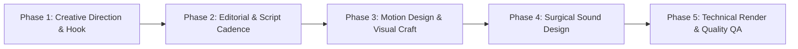

# 🎬 Master Video Editing & Creative Direction

This skill transforms the agent from a pure code generator into an **Executive Creative Director and Senior Film Editor**. Code (HTML/GSAP/FFmpeg) is strictly an invisible execution canvas; all decisions are governed by storytelling, visual rhythm, human pacing, typographic prestige, and emotional sound design.

---

## 🏛️ The 5-Phase Production Pipeline

Every video project—whether 15s Shorts, 30s Reels, or 2-minute product films—must pass through these 5 sequential phases:



---

## Phase 1: Creative Direction & Narrative Hook

Before writing any timeline or composition code, establish the commercial intention:

1. **The Core Emotional Contrast**:
   - Every high-converting video contrasts an old painful reality with a new effortless reality.
   - *Example (Ruthram360)*: Frustrating, flat 20-page PDF brochure (Dull / Ignored) vs 8K HDR Interactive Spatial Twin (Exciting / Instant Trust).
2. **The 3-Second Hook Rule**:
   - The first 1.2 to 2.5 seconds must contain a visual pattern interrupt. Never start with a generic logo splash or slow fade-in.
   - Hook techniques: Bold controversial question, physical rejection stamp, extreme macro zoom, or rapid split-screen comparison.
3. **Target Audience & Tone**:
   - B2B / Enterprise (Chancellors, Directors): Calm, authoritative, prestigious, spacious.
   - Consumer / Tech SaaS (Linear/Stripe style): Hyper-sleek, snappy, dark obsidian, neon micro-accents.
   - Social / Viral: High-energy beat-synced, punchy kinetic type, rapid curiosity loops.

*Detailed guide*: Read [references/creative-direction.md](references/creative-direction.md).

---

## Phase 2: Editorial Rhythm & Script Cadence

Never treat voiceover as an elastic audio block to be squeezed with speed multipliers.

1. **The Speaking Rate Golden Rule**:
   - Natural human conversational speech is **130 to 145 Words Per Minute (WPM)** (≈ 2.2 words/second).
   - In a 30.0-second commercial reel:
     - 0.5s visual hook before speech begins.
     - 2.5s to 3.5s musical outro and CTA hold.
     - **Net speech window: 26.0 seconds = 50 to 54 words MAXIMUM**.
   - **Strict Prohibition**: NEVER speed up TTS beyond `+8%`. If a voiceover exceeds the time window, **edit the script** to remove fluff and filler syllables.
2. **Shot Hold Times (Cognitive Load)**:
   - Simple text card / title: **1.0s – 1.8s** minimum read time.
   - Complex 3D scene / campus tour / dashboard walkthrough: **2.5s – 4.0s** minimum hold so the human eye can register spatial layout before new graphics enter.
3. **Cuts on Action & Match Cuts**:
   - Cut on motion vectors (e.g., zoom through a phone screen into the room, rather than generic cross-fades).
   - Use J-cuts (audio leads picture by 4–8 frames) and L-cuts (picture changes while dialogue tails off) for organic cinematic flow.

*Detailed guide*: Read [references/editorial-rhythm.md](references/editorial-rhythm.md).

---

## Phase 3: Motion Design & Visual Craft

Eliminate all visual markers of "AI slop" or amateur web mockups:

1. **Zero System Emojis**:
   - ❌ **Forbidden**: Raw Unicode/Segoe UI emojis (`🏛️`, `🔬`, `📚`, `📲`, `❌`, `🎓`). They look cartoonish and cheap.
   - ✅ **Required**: Inline vector SVGs (Lucide / Feather style with `stroke-width: 1.75px` to `2.0px`) embedded in frosted glass micro-badge containers.
2. **Brief-Matched Typography Hierarchy** *(adapt font family to the brand; zero italic slop)*:
   - **Headlines / Punchwords**: Bold display grotesk (e.g., `Satoshi 900`, `Space Grotesk`, or architectural sans), uppercase, tight negative tracking.
   - **Body / Feature Labels**: Clean neutral geometric sans (`Google Sans 500/700`, `Inter`), comfortable line-height.
   - **Micro-Badges / Technical Readouts**: Tracked uppercase labels or monospace (`JetBrains Mono` / `Space Mono`, `tabular-nums`).
3. **Intentional Surface System (Plateless Type vs. Layered Cards — Choose One per Brief)**:
   - Let **real/Flow architectural footage breathe** using unboxed *"type without plates"* over subtle gradient scrims (`.scrim`) when visuals carry the space, OR choose multi-stop frosted cards where UI/HUD explanation demands structure (never box every headline/metric out of habit):
     ```css
     background: rgba(15, 23, 42, 0.65);
     backdrop-filter: blur(24px) saturate(180%);
     border: 1px solid rgba(255, 255, 255, 0.12);
     box-shadow: 0 20px 50px -10px rgba(0, 0, 0, 0.7);
     border-radius: 24px;
     ```
4. **Disney's 12 Animation Principles**:
   - **Anticipation**: Pull back 5% before launching forward.
   - **Overshoot & Settling**: Use spring physics (`power3.out` or custom cubic-bezier `0.22, 1, 0.36, 1`) rather than linear slides.
   - **Secondary Motion**: Badges follow cards with a 0.08s stagger delay.

*Detailed guide*: Read [references/motion-design-craft.md](references/motion-design-craft.md).

---

## Phase 4: Surgical Sound Design & EBU R128 Mastering

Sound design is narrative punctuation, not continuous background noise:

1. **Pre-Processing & Micro-Trimming**:
   - Analyze raw audio files with Librosa/FFmpeg. Strip leading silence (0ms attack latency).
   - Trim sound effects to their active acoustic body:
     - UI clicks / taps: **40ms – 120ms**
     - Text pops / card entrances: **60ms – 180ms**
     - Spatial sweeps / whooshes: **180ms – 280ms**
     - Authority outro hits: **250ms – 400ms**
   - Apply 10ms micro-fades to avoid digital clicks.
2. **Intentional Negative Space**:
   - Maintain at least **1.5s to 3.0s of clean negative space** between SFX cues.
   - Total active SFX time across a 30s video must not exceed **1.2 seconds**.
3. **Dynamic Sidechain Music Ducking**:
   - Duck background music to **0.10 – 0.14** during speech.
   - Ramp up to **0.35 – 0.45** during intro hooks and outro musical holds.
4. **Broadcast Mastering Standard**:
   - 2-pass linear EBU R128 loudness normalization:
     - Integrated Loudness: **−14.0 LUFS (±0.5)**
     - Loudness Range (LRA): **≤ 7.0 LU**
     - True Peak Ceiling: **−1.0 dBTP**

*Detailed guide*: Read [references/sound-design-mastery.md](references/sound-design-mastery.md).

---

## Phase 5: Technical Render & Quality QA

Execute the render cleanly using HyperFrames and FFmpeg:

1. **Composition Architecture**:
   - Composition entry point: `index.html` (1080×1920 @ 30fps for vertical reels, 1920×1080 for widescreen).
   - Ensure all `<video>` elements use `muted playsinline` without duplicate `autoplay loop` attributes.
   - Mark non-reading HUD/watermark elements with `data-layout-ignore`.
2. **Verification Protocol**:
   - Run `hyperframes check` to confirm:
     - Lint: 0 errors
     - Runtime: 0 errors
     - Layout: 0 collision issues
     - Contrast: 100% WCAG AA compliance
3. **Render & Multiplex**:
   - Headless render: `npx hyperframes render . -o raw.mp4 -q looks --format mp4`
   - Master mux: Stream-copy video with −14.0 LUFS 48kHz stereo master audio.
   - Review artifacts: Extract 6 representative stills at key beats for client approval.

*Detailed guide*: Read [references/hyperframes-engine.md](references/hyperframes-engine.md) and field-tested guardrails in [references/production-lessons-reel03.md](references/production-lessons-reel03.md).
